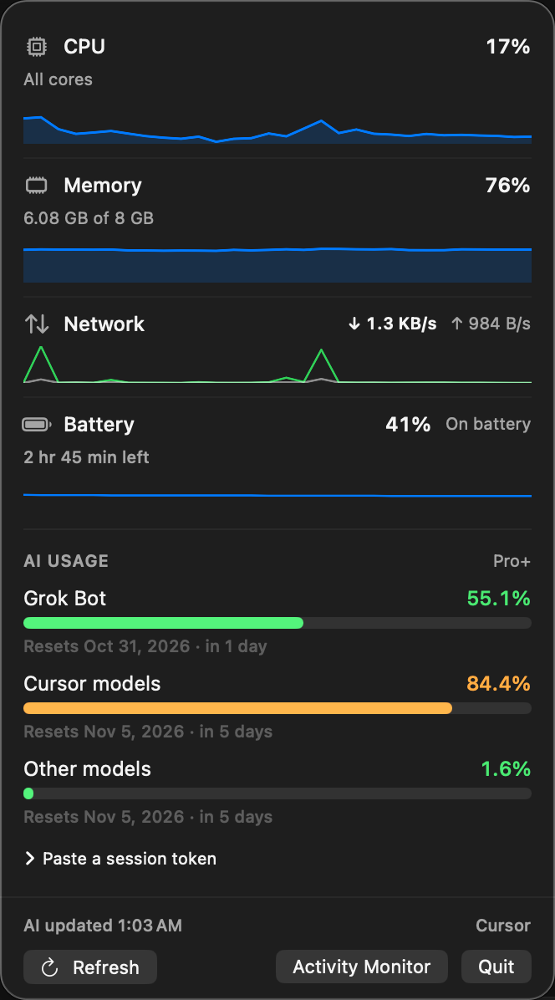
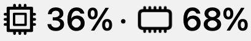

# menubar-usage

A macOS menu bar app for CPU, memory, Grok Bot, and Cursor model usage. It has no Dock icon and no main window. Click the status item to open the panel, and quit from that panel.

Requires macOS 13 or later. The status item is a SwiftUI `MenuBarExtra` with the `.window` style, and the app is an agent (`LSUIElement`).


## Screenshots



CPU, memory, network, battery, and AI usage in the menu bar panel.



Menu bar status item (CPU and memory).

## Build and run

Open `MenuBarUsage.xcodeproj` and run the MenuBarUsage scheme, or from the repo root:

```bash
xcodebuild -project MenuBarUsage.xcodeproj -scheme MenuBarUsage -configuration Debug -destination 'platform=macOS' -derivedDataPath build/DerivedData build
open build/DerivedData/Build/Products/Debug/MenuBarUsage.app
```

Tests:

```bash
xcodebuild -project MenuBarUsage.xcodeproj -scheme MenuBarUsage -destination 'platform=macOS' -derivedDataPath build/DerivedData test
```

The Debug build is ad-hoc signed so it can run on the machine that built it. For a copy you hand to someone else, sign it with your Apple Development team in Xcode (Signing & Capabilities).

The built app is an agent, so it shows in the menu bar and not the Dock. Quit with the Quit button in the panel.

Finder, Launchpad, and Applications use the icon in `MenuBarUsage/Assets.xcassets/AppIcon.appiconset`. The menu bar status item is still the CPU and memory symbols, not this icon.

A non-interactive check prints CPU, memory, the auth source, and usage rows, then exits. It does not print the session token:

```bash
build/DerivedData/Build/Products/Debug/MenuBarUsage.app/Contents/MacOS/MenuBarUsage --dump
```

The status item is one template image laid out by AppKit: a monochrome `cpu` symbol, the CPU percent, a middle dot, a monochrome `memorychip` symbol, and the memory percent. Inspect that image before installing:

```bash
build/DerivedData/Build/Products/Debug/MenuBarUsage.app/Contents/MacOS/MenuBarUsage --dump-status-image /tmp/status.png
```

That writes a 4× preview of the `36%` / `68%` label. It does not spell CPU or Mem, and it does not include the chart-bars icon. Network, battery, and AI usage stay in the panel.

## What the panel shows

The panel opens on this Mac. CPU, memory, network, and battery are the first group. Cursor and Grok usage follow in a shorter **AI usage** section. There is no "Usage" title and no plan badge at the top. The plan name is a caption on the AI section. The footer opens Activity Monitor.

- **CPU**: percent from Mach host CPU ticks, an “All cores” line, and a graph of recent samples scaled from 0 to 100. Refreshed about every 3 seconds while the panel is open, and about every 5 seconds while it is closed. The first percent arrives after the second tick, about a second after launch. Sampling pauses while the Mac is asleep, the displays are asleep, or the session is locked.
- **Memory**: used and total, and a graph of recent used percent on the same scale and cadence. Used memory is active + wired + compressed pages; the total is `ProcessInfo.physicalMemory`.
- **Network**: down and up rates for the primary interface, with a short sparkline of recent samples. Same cadence as CPU. The primary interface name is cached for about 45 seconds.
- **Battery**: percent, whether it is charging, on AC power, or on battery, and time remaining when the system reports it. Desktops with no battery omit this row. Checked about every 30 seconds and when the power source changes. A short sparkline shows recent charge level.
- **AI usage**: Grok Bot and Cursor pools. About every 90 seconds while the panel is open, and about every 12 minutes while it is closed. Opening the panel refreshes immediately when the last result is more than a minute old. Plan info is requested at most once an hour. A transport failure backs off, up to 30 minutes. The session-token control stays here, collapsed.

Legacy Cursor plans (Pro, Pro+, and the other monthly plans) keep separate meters:

- **Grok Bot**, with its reset.
- **Cursor models** — `autoPercentUsed`, reset at `billingCycleEnd`.
- **Other models** — `apiPercentUsed`, when that pool is separate. The row is the percent, bar, and reset.

The X Subscription shares one weekly Cursor-model pool across Cursor and Grok Bot. On that plan the panel shows a single **Included AI usage** row, plus **Other models** only when that pool is actually separate. The same percentage is not drawn twice. A weekly plan whose monthly pools are both sitting at 0 while the week is partly spent does not show a fake 0% Other models row.

`totalPercentUsed` is the included figure only when the two pools are not reported. `plan.used` / `plan.limit` is a different denominator and is not shown next to the pool percentages.

## Authentication

No token is committed, logged, or copied into the repo.

1. A session token you paste is stored in the login Keychain under `com.jxzheng.menubar-usage.session` and is used first. Forget removes it. After a successful read it stays in memory, and it is read from the Keychain again at launch, on save or forget, when Cursor rejects it, and when the token is close to expiring.
2. Otherwise the app reads `cursorAuth/accessToken` from Cursor's local `state.vscdb` on each refresh and builds a `WorkosCursorSessionToken` cookie from the JWT `sub` and the token. That token is not written to this app's Keychain. The database is read again on the next refresh.

Current Cursor builds seal that row when `cursor.storage.authTokenEncryptionAtRest` is on. The cell is `cursor-safe-storage:v1:` plus the base64 of an Electron `safeStorage` ciphertext (`v10` or `v11`, AES-128-CBC). The password is the login Keychain item Cursor already created: service `Cursor Safe Storage`, account `Cursor Key` (older Electron builds used the account `Cursor`). The app derives the AES key from those bytes and decrypts the row. macOS asks the first time the panel is open. Choose Allow, or Always Allow so later launches stay quiet. A denial stays quiet until Refresh or the next time the panel opens. Background polling does not raise the dialog. The derived key stays in memory for this launch. The JWT is read from the database on each refresh.

A plaintext JWT from an older Cursor install is still accepted and does not read that Keychain item. The same `Cursor Safe Storage` item is used for every database above.

Databases, first match that has a usable token:

- `~/Library/Application Support/Cursor/User/globalStorage/state.vscdb`
- `~/Library/Application Support/Cursor - Insiders/User/globalStorage/state.vscdb`
- `~/Library/Application Support/Cursor Nightly/User/globalStorage/state.vscdb`

The database is opened read-only. The only row read is `cursorAuth/accessToken`.

If Cursor is signed out, the session is expired, the Keychain prompt is denied, or the sealed blob does not open, the panel says so and leaves the percentages blank. Nothing is filled in as a guess. Paste a session token if the Keychain item is missing. This build does not read the browser cookie database. Opening Cursor schedules the same usage refresh as the panel. It does not rewrite a sealed token as plaintext. The usage dashboard remains available at [cursor.com/dashboard/usage](https://cursor.com/dashboard/usage).

The app is not sandboxed, because a sandboxed app cannot read Cursor's Application Support database.

## Usage requests

These are the dashboard calls the Cursor site already makes. They are undocumented and can change.

- `GET https://cursor.com/api/usage-summary` with the `WorkosCursorSessionToken` cookie. `billingCycleEnd` is the reset. Pool percentages are `autoPercentUsed`, `apiPercentUsed`, and `totalPercentUsed`.
- `POST https://cursor.com/api/dashboard/get-plan-info` to see whether included usage is weekly. This is sent at launch and then at most once an hour.
- `POST https://cursor.com/api/dashboard/get-current-period-usage` for the weekly included percent when the plan says the pool is weekly.
- `POST https://cursor.com/api/dashboard/get-sand-usage-status` for Grok Bot's own allowance. The row is omitted when the account has no included Bot allowance.

Redirects are not followed, so the session cookie is not sent on to another host.

## License

MIT. See [LICENSE](LICENSE).
